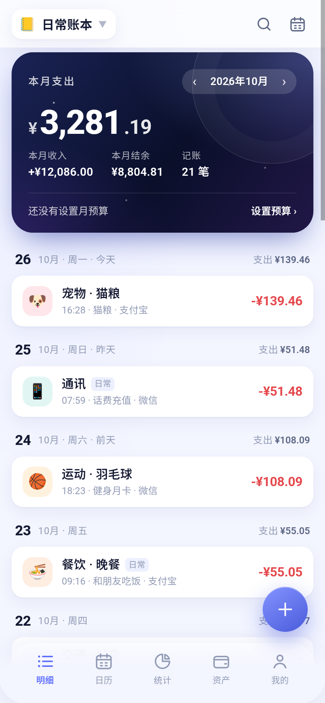
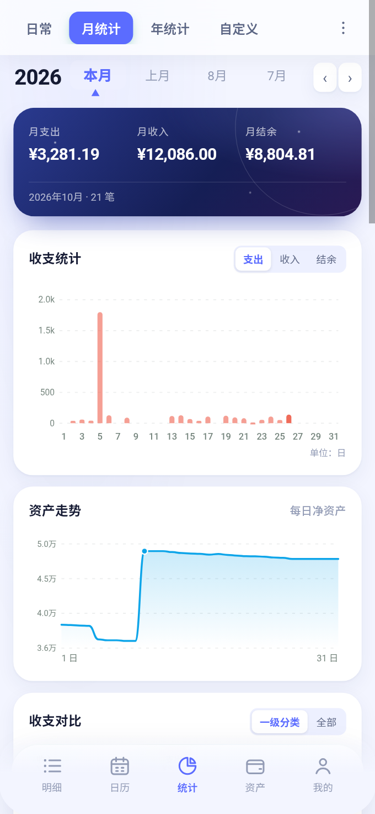

# 星空记账 · 极简本地记账

一个以星空为主题的本地优先记账 App：账单、账户、日历、统计和备份都保存在本机。
包含 **Android APK**（WebView 封装，离线可用）和 **Web / PWA 源码**。

- 仓库：<https://github.com/sxy666sxy/ledger>
- APK 下载：<https://github.com/sxy666sxy/ledger/releases/latest>
- 直链（v2.0.0）：<https://github.com/sxy666sxy/ledger/releases/download/v2.0.0/xingkong-ledger-v2.0.0.apk>

## 预览

| 明细 | 统计 | 我的 |
| --- | --- | --- |
|  |  |  |

## 下载与安装（Android）

1. 打开 [Releases](https://github.com/sxy666sxy/ledger/releases/latest)，下载 `xingkong-ledger-v2.0.0.apk`。
2. 在手机上点击 APK，允许「安装未知来源应用」，安装完成即可使用。
3. 首次打开会生成近 3 个月的示例账单，可在「我的 → 数据与备份」清空。

说明：

- APK 是 **WebView 封装版**，不申请网络权限，完全离线。
- v2.0.0 更名为 **星空记账**，包名改为 `com.xingkong.ledger`，并使用新的 release 签名密钥；与 v1.x 不能覆盖升级。
- 从旧版升级：先在旧版「数据与备份」导出 JSON，卸载旧版，再安装 v2.0.0，最后导入 JSON。
- 数据保存在 App 的 WebView `localStorage` 中，卸载会清除；重要数据请定期导出 JSON。
- 导出 JSON / Excel / CSV 时会调用系统文件选择器（SAF）。

「我的」界面已移除 PWA「安装到手机」入口；Android 请直接使用 APK。

## 账单字段与 Excel

导出的 Excel / CSV 列与星空记账账单一致，共 23 列：

```
日期	收支类型	金额	类别	二级分类	账户	账本	退款	优惠	备注	标签
报销账户	报销金额	报销明细	多币种	地址	创建用户	其他	附件1	附件2	附件3	附件4	附件5
```

约定：

- **日期**：`YYYY-MM-DD`（时间保留在 JSON 备份中；Excel 只有日期列）。
- **收支类型**：支出 / 收入 / 转账。
- **金额**：正数；支出/收入由「收支类型」区分。
- **类别 / 二级分类**：一级分类名 + 可选的二级分类（例如 餐饮 / 午餐）。
- **账户**：普通账单为账户名；转账写成 `银行卡 → 微信`（表里没有单独的转入账户列）。
- **账本**：账单所属账本，导出包含全部账本。
- **退款 / 优惠 / 报销金额**：数字，空表示无；属于记录字段，不改变账户余额和收支统计。
- **多币种**：例如 `USD 12.50`，主金额仍为人民币。
- **附件1-5**：最多 5 个附件，Excel/CSV 只写文件名；JSON 备份包含压缩后的图片数据。
- **创建用户 / 地址 / 其他**：自由文本。

导入：

- 支持 **Excel (.xlsx)** 和 **CSV**，按表头匹配列；也兼容旧版「日期/时间/类型/分类/金额…」表头。
- 账单导入为**追加合并**：自动创建缺失的账本、分类、账户，重复账单会跳过。
- JSON 备份导入是**覆盖恢复**，包含全部字段和附件。

## 功能

### 记账

- 数字键盘快速记账，支持 `12+3.5-1` 这类加减算式
- 支出 / 收入 / 转账；转账不计入收支，只改变账户余额
- 19 个支出分类 + 8 个收入分类，可改名、换图标、换颜色、新增自定义分类
- 日期、账户、备注、标签一次填完；点击账单可编辑 / 删除
- **更多账单信息**：二级分类、退款、优惠、报销账户 / 金额 / 明细、多币种、地址、创建用户、其他、附件图片（最多 5 张）
- 多账本（日常 / 旅行 / 装修……），账单、预算独立，账户共用

### 明细增强

- 支出金额红色、收入金额绿色，一级分类字重更轻
- 每条账单显示具体记账时间（时:分）
- 长按账单进入多选：全选 / 导出 Excel 或 CSV / 删除 / 取消
- 明细页顶部下拉，松手直接打开记账面板

### 日历

- 底部导航「明细 → 日历 → 统计 → 资产 → 我的」
- 顶部液态玻璃卡片：月份切换、收 / 支 / 余
- 日历格显示农历、节气、节日（春节/中秋/国庆/霜降/万圣节等）和每日收支
- 右上角设置可开关热力背景：支出越红、收入越绿
- 点击任意日期，下方显示当天账单，并可添加当天账单

### 资产

- 点击账户余额可直接改当前余额：自动反推初始余额，已有账单不变
- 长按账户删除；若账户关联账单/周期规则，会提示并一并删除
- 账户余额、信用卡负债、净资产、转账

### 统计页

- 顶部固定四个入口：**日常 / 月统计 / 年统计 / 自定义**
- 日常：最近 7 天概况，柱状图直接标金额
- 月统计：年月选择、左右滑动月份（箭头固定在第一位）、月支出/收入/结余、按日柱状图（支出/收入/结余切换）、每日净资产曲线、收支桑基对比（一级分类/全部）、分类占比、排行、报表统计、月份总结
- 年统计：全年汇总、12 个月柱状图、分类占比/排行、月度报表、年度总结
- 自定义：任意日期区间，默认近 7 天
- 月份栏支持左右两侧切换：一次滑动只切换一个月，左右步进按钮，动画过渡
- 五个主界面支持左右滑动切换：明细 → 日历 → 统计 → 资产 → 我的

### 液态玻璃

- 顶部栏、底部悬浮导航、日历头部、多选操作条、下拉提示均使用半透明毛玻璃；内容滚动时保持可读
- 底部导航为悬浮胶囊，5 个标签；新增按钮独立悬浮在右下

### 首页 / 资产

- 当月支出 / 收入 / 结余 / 笔数，月预算进度，按日分组明细
- 统计图表：日/月/年柱状、资产曲线、收支桑基、分类环形与排行
- 账户余额自动计算、信用卡负债、净资产、账户转账
- 账单日历、全文搜索、周期记账

### 导入标签智能归类

- 导入 Excel / CSV 时，标签会与内置标签/已有分类做相似匹配
- 例如内置标签「餐饮」，导入标签「食品餐饮」「餐饮美食」会归为「餐饮」
- 无法可靠匹配时保留原标签，不强行合并

### 数据

- **导出 Excel (.xlsx)**：绿色表头、冻结首行、自动筛选、金额列数字格式
- **导出 CSV**：同样的 23 列，带 BOM，Excel/WPS 直接打开不乱码
- **导出 JSON 备份**：完整数据 + 附件图片
- **导入 Excel / CSV**：合并追加、自动建分类/账户/账本、去重
- **导入 JSON 备份**：覆盖恢复
- 深色模式、4 位隐私锁、离线可用
- 全局隐藏滚动条，日历 / 我的页禁止顶部下拉回弹

## 数据与隐私

- APK：数据在 `file:///android_asset/index.html` 对应的 WebView localStorage，位于 App 私有目录，不联网、不上传。
- Web：`localStorage`，键名 `xingkong.ledger.v4`。
- 图片附件会压缩到 600px 后以 data URL 保存，尽量少放；localStorage 空间有限（约 5MB）。
- 清理数据 / 卸载 App / 换设备会丢失，**请定期导出 JSON 备份**。
- 换域名、换端口会变成另一份 Web 数据；APK 不受影响。

## 构建 APK

### 自动构建（推荐）

推送到 `main` 后，GitHub Actions 自动：

1. 用 `build.mjs` 生成单文件 Web 资源；
2. 复制到 `android/app/src/main/assets/index.html`；
3. JDK 17 + Android SDK 34 + Gradle 8.7 构建 release APK（使用仓库 Secrets 中的固定签名）；
4. 上传 artifact，并发布到 `v1.1.0` Release。

工作流：[.github/workflows/android.yml](.github/workflows/android.yml)

### 本地构建

需要 Node 20+、JDK 17、Android SDK（platform 34 + build-tools 34.0.0）与 Gradle 8.7。

```bash
node build.mjs
mkdir -p android/app/src/main/assets
cp dist/*.html android/app/src/main/assets/index.html
cd android
gradle assembleDebug
# 产物：app/build/outputs/apk/debug/app-debug.apk
```

## Web 版

```bash
python3 serve.py 8765
# 打开 http://127.0.0.1:8765/
```

- 仍然是可离线 PWA：manifest、Service Worker、图标齐全；可以通过浏览器菜单安装，但 App 界面不提供「安装到手机」入口。
- 单文件版：[dist/星空记账.html](dist/星空记账.html)，CSS/JS/图标全部内联。
- Excel 读写：[assets/xlsx.js](assets/xlsx.js)（自写 ZIP + SpreadsheetML，无第三方依赖）。
- APK 壳：[MainActivity.java](android/app/src/main/java/com/xingkong/ledger/MainActivity.java)，负责 assets 加载、文件选择（SAF）、JSON/Excel/CSV 导出与返回键关闭面板。

## 目录结构

```
ledger/
├── index.html                  # Web 入口
├── manifest.webmanifest        # PWA 清单
├── sw.js                       # Service Worker
├── serve.py                    # 本地服务器（正确 MIME / 缓存头）
├── assets/
│   ├── app.css / core.js / charts.js / app.js
│   ├── xlsx.js                 # Excel 导入导出（无依赖）
│   └── icons/
├── android/                    # Android WebView 壳
│   └── app/src/main/
│       ├── AndroidManifest.xml
│       ├── java/com/xingkong/ledger/MainActivity.java
│       ├── res/                # 图标、主题、字符串
│       └── assets/             # 构建时写入 index.html
├── .github/workflows/android.yml
├── dist/星空记账.html
├── screenshots/
├── tests/
│   ├── core.test.mjs / ui.test.mjs
│   ├── xlsx.test.mjs           # Excel 往返 + openpyxl 生成文件解析
│   ├── pwa.test.mjs / singlefile.test.mjs
│   └── fixtures/import.xlsx
├── tools/make_icons.py
├── build.mjs / package.json
└── README.md
```

## 测试

共 54 项：

- 数据层 18 项
- jsdom 界面 25 项
- Excel 6 项（23 列表头、xlsx 构建/解析、openpyxl 文件导入、CSV 往返、旧表头兼容）
- PWA 4 项
- 单文件构建 1 项

```bash
npm install
npm test
```

## 设计说明

- 原生 APK 是 WebView 封装，不是原生 UI 重写
- 暂无云同步 / 多设备、多人账本、微信/支付宝账单导入、OCR、桌面小组件、记账提醒、指纹解锁
- v2.0.0 使用新的包名与签名；旧版升级请先导出 JSON 备份（见上）
- 日历节日覆盖农历节日、公历节日与二十四节气，不含每年法定调休表

## 声明

本项目为独立实现的个人本地记账工具，与任何第三方记账产品无关联。
